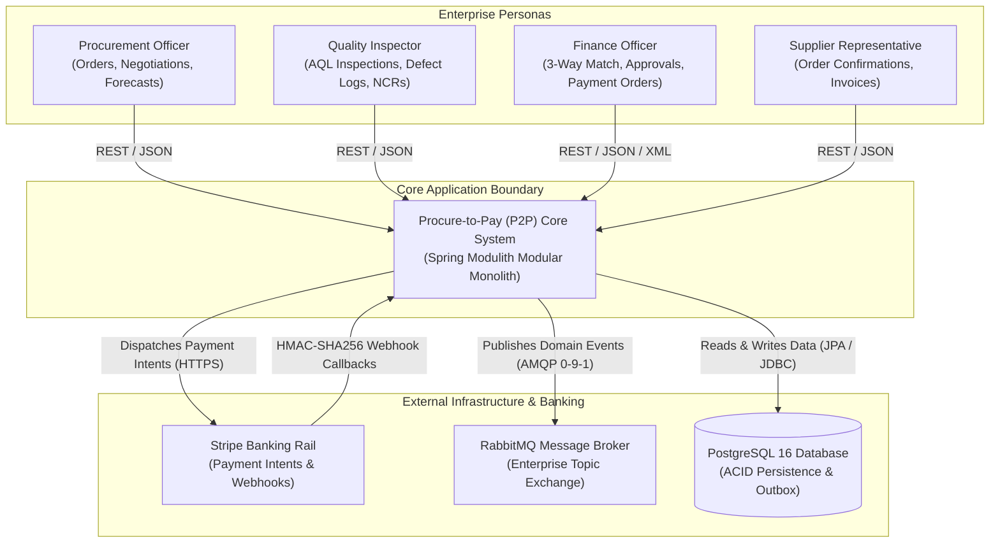
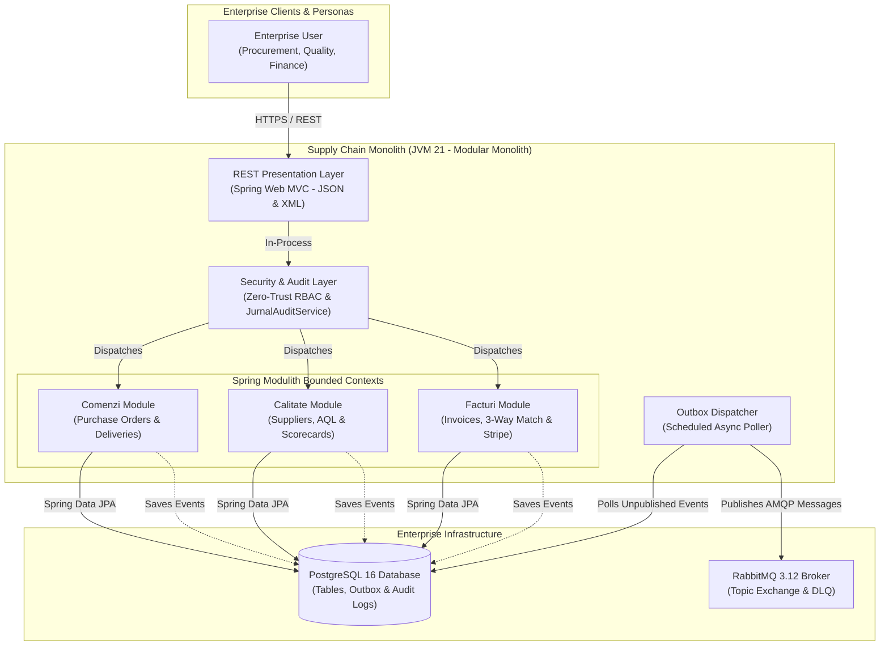

# 02. SYSTEM OVERVIEW & C4 ARCHITECTURAL CONTEXT
**System:** Enterprise Procure-to-Pay (P2P) Supply Chain Modular Monolith  
**Namespace:** `ro.uaic.feaa.sdbis.supplychain`

---

## 1. SYSTEM CONTEXT (C4 LEVEL 1)

The Procure-to-Pay platform acts as the operational core connecting enterprise staff, external suppliers, banking networks, and event-driven enterprise service buses.

---

## 2. SYSTEM CONTAINER TOPOLOGY (C4 LEVEL 2)

Within the monolithic runtime, logical boundaries partition duties into distinct execution components sharing a single JVM process while isolating operational concerns.

---

## 3. SUBSYSTEM INVENTORY & CORE RESPONSIBILITIES

### A. Subsystem: Comenzi (Purchasing)
- **Primary Aggregate:** `ComandaAprovizionare` (Root) encapsulating collection `LinieComanda` and `Lot`.
- **Key Responsibilities:**
  - Authoring and updating purchase orders.
  - Tracking supplier promised delivery dates.
  - Cascading cancellations: When an order is cancelled, all pending uninspected lots are transitioned to `ANULAT` atomically.
  - Algorithmic lead time forecasting benchmarked to complete under $300\text{ ms}$ across $1,000$ historical orders.

### B. Subsystem: Calitate (Quality Assurance & Vendor Governance)
- **Primary Aggregates:** `Furnizor`, `InspectieCalitate`, `ScorecardLunar`, `InspectorCalitate`.
- **Key Responsibilities:**
  - Supplier qualification lifecycle: `CANDIDAT` $\rightarrow$ `CALIFICAT` $\rightarrow$ `APROBAT` (or `CONDITIONAT`, `BLOCAT`).
  - ISO 2859-1 (AQL) statistical inspection execution: Validates sample sizes and defect thresholds ($Ac$, $Re = Ac + 1$).
  - Non-Conformance Report (NCR) workflows: Root cause analysis, corrective action plans, escalation.
  - Monthly supplier evaluation scorecards:
    $$\text{Total Score} = 0.40 \times \text{OTIF} + 0.40 \times \text{Quality} + 0.20 \times \text{Price Compliance}$$
    Triggers automatic rehabilitation or immediate suspension/blocking upon 3 consecutive non-compliant lots.

### C. Subsystem: Facturi (Accounts Payable & Financial Integration)
- **Primary Aggregates:** `FacturaFurnizor`, `NIR` (Reception Note), `OrdinPlata`.
- **Key Responsibilities:**
  - Reception processing: Generating Goods Receipt Notes (`NIR`) upon lot arrival.
  - 3-Way Matching (`ReconciliereService`): Reconciles Purchase Order vs. Reception Note vs. Supplier Invoice within a $\pm 2\%$ tolerance window. Discrepancies lock invoices into `BLOCATA_DISCREPANTE`.
  - Payment Order lifecycle: Creates `OrdinPlata`, enforces Four-Eyes approval for amounts $>10,000\text{ EUR}$.
  - Stripe Sandbox/Production Banking Gateway: Connects to Stripe `PaymentIntent`, verifies incoming webhooks using HMAC-SHA256, and finalizes invoice payments idempotently.

---

## 4. NON-FUNCTIONAL BASELINE & SERVICE LEVEL TARGETS

| SLA / NFR Code | Operational Characteristic | Technical Implementation & Target Metric | Verification Method |
| :--- | :--- | :--- | :--- |
| **NFR-SLA-01** | Lead Time Calculation Speed | Executed in $<300\text{ ms}$ over 1,000 historical records | `PerformanceAndSlaTest` |
| **NFR-SLA-02** | Goods Receipt Idempotency | Duplicate reception events produce 0 redundant NIR records | `PaymentWorkflowIntegrationTest` |
| **NFR-SLA-04** | Atomic Cascade Cancellation | Synchronous aggregate rollback in a single database transaction | `CascadeCancellationIntegrationTest` |
| **NFR-SLA-05** | Batch Reconciliation Speed | Reconciles 5,000 invoices in $<60\text{ seconds}$ | `PerformanceAndSlaTest` |
| **NFR-SLA-06** | Four-Eyes Financial Control | Strict rejection if `aprobatDe == creatDe` for sums $>10,000\text{ EUR}$ | `ControlFinanciarUnitTest` |
| **SEC-WH-01** | Webhook Cryptographic Authenticity | Mandatory `Stripe-Signature` validation, 300s replay window | `FacturaCtrlRestTest` |

