# 03. BUSINESS ANALYSIS & CORE BUSINESS CAPABILITY SPECIFICATIONS
**System:** Enterprise Procure-to-Pay (P2P) Supply Chain Modular Monolith  
**Namespace:** `ro.uaic.feaa.sdbis.supplychain`

---

## 1. STRATEGIC BUSINESS DOMAIN & VALUE STREAM

In modern enterprise manufacturing, procurement risk directly impacts liquidity, production continuity, and regulatory compliance. The Procure-to-Pay (P2P) value stream coordinates cross-departmental operations:

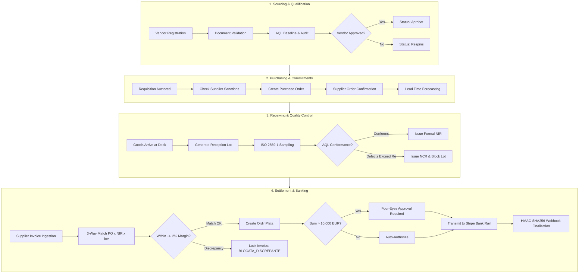

---

## 2. BUSINESS RULES & REGULATORY GOVERNANCE MATRIX

| Rule ID | Domain Concept | Business Rule Specification | Technical Enforcement Mechanism |
| :--- | :--- | :--- | :--- |
| **BR-PO-01** | Supplier Eligibility | Purchase orders can only be issued to suppliers in status `Aprobat` or `Conditionat`. Candidates or blocked suppliers must be rejected. | `ComandaApplicationService` queries `ICalitateModuleApi.isFurnizorEligibil()`; returns HTTP 422 if false. |
| **BR-PO-02** | Line Uniqueness | An order cannot contain duplicate line items for the same `CodMaterial`. Quantities must be consolidated. | Aggregate invariant in `ComandaAprovizionare.adaugaLinie()`. |
| **BR-PO-03** | Cascade Cancellation | Cancelling an order automatically marks all associated pending shipments and uninspected lots as `ANULAT`. | Synchronous domain mutation in `ComandaAprovizionare.anuleazaComanda()`. |
| **BR-SQ-01** | Sanction Defense | A supplier with 3 consecutive non-conforming lots must be automatically transitioned to `BLOCAT`. | `Furnizor.inregistreazaInspectieNeconforma()`. |
| **BR-SQ-02** | Weighted Scorecard | Monthly evaluation calculates: $\text{Score} = 0.40 \cdot \text{OTIF} + 0.40 \cdot \text{Quality} + 0.20 \cdot \text{Price}$. | Domain Service `CalculScorecardService.calculeaza()`. |
| **BR-SQ-03** | AQL Invariants | For ISO 2859-1 sampling, the rejection threshold $Re$ must strictly equal acceptance threshold $Ac + 1$. | Enforced in domain constructor of `InspectieCalitate` and Flyway `chk_inspectii_aql`. |
| **BR-IP-01** | 3-Way Matching | Quantities and unit prices across Purchase Order, Goods Receipt (NIR), and Invoice must match within $\pm 2\%$. | `ReconciliereService.reconciliaza()`; sets `BLOCATA_DISCREPANTE` if invalid. |
| **BR-IP-02** | Four-Eyes Control | For payment orders $>10,000\text{ EUR}$, the approving officer must differ from the creator (`creatDe \ne aprobatorId`). | Aggregate guard clause in `OrdinPlata.aproba()`. |
| **BR-IP-08** | Sanction Lockout | Invoices belonging to a supplier marked as `BLOCAT` are barred from payment order generation or bank dispatch. | Checked via `FurnizoriBlocatiRepo.esteBlocat(furnizorId)`. |

---

## 3. EXHAUSTIVE BUSINESS PROCESS CAPABILITY WORKFLOWS

### Capability 1: Purchase Order Creation

* **Objective:** Instantiate a legally binding purchase contract with an approved vendor.
* **Business Context:** Procurement requisitions translated into executable supply chain purchase orders.
* **Actors:** Procurement Officer (`ROLE_BUYER`), Quality Context (`ICalitateModuleApi`).
* **Preconditions:** Buyer is authenticated; vendor exists and is qualified; requested delivery date is future-or-present.
* **Main Flow:**
  1. Buyer submits `CreeazaComandaRequest` via `POST /api/comenzi`.
  2. System validates JSR-380 constraints (`@NotBlank`, `@NotEmpty`, `@FutureOrPresent`).
  3. System synchronously calls `ICalitateModuleApi.isFurnizorEligibil(furnizorId)`.
  4. System instantiates `ComandaAprovizionare` aggregate root in status `Solicitat`.
  5. System computes subtotal for each line item and derives `valoareTotala`.
  6. Order is persisted to `comenzi_comenzi` and `comenzi_linii_comanda`.
  7. `ComandaCreataEvent` is appended to `shared_outbox_events`.
  8. System returns HTTP 201 Created with order UUID and reference number.
* **Alternative Flows:** If lead time forecasting exceeds requested date, `EstimareDepasesteCerereaEvent` alert is raised.
* **Failure Flows:** If vendor status is `Candidat`, `Suspendat`, or `Blocat`, system throws `SupplierNotEligibleException` (HTTP 422).
* **Postconditions:** Order created in status `Solicitat`; outbox record committed.
* **Business Rules:** BR-PO-01, BR-PO-02.
* **Related Requirements:** FR-PO-01, FR-PO-02.

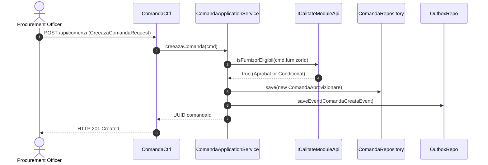

---

### Capability 2: Supplier Registration

* **Objective:** Onboard a new vendor into the enterprise supplier registry.
* **Business Context:** Vendor master data management prior to qualification audits.
* **Actors:** Quality Manager / Procurement Officer (`ROLE_QUALITY_INSPECTOR`, `ROLE_ADMIN`).
* **Preconditions:** Corporate tax ID (CIF) and IBAN must be structurally valid.
* **Main Flow:**
  1. Operator submits `InregistreazaFurnizorRequest` via `POST /api/furnizori`.
  2. System verifies CIF uniqueness in `calitate_furnizori`.
  3. System instantiates `Furnizor` aggregate root in initial state `Candidat`.
  4. System persists vendor record and logs action in `shared_audit_log`.
  5. System returns HTTP 201 Created with generated vendor UUID.
* **Alternative Flows:** None.
* **Failure Flows:** Duplicate CIF throws `DuplicateSupplierException` (HTTP 409); malformed IBAN returns HTTP 400.
* **Postconditions:** Vendor persisted in status `Candidat`.
* **Business Rules:** BR-SQ-01.
* **Related Requirements:** FR-QA-01.

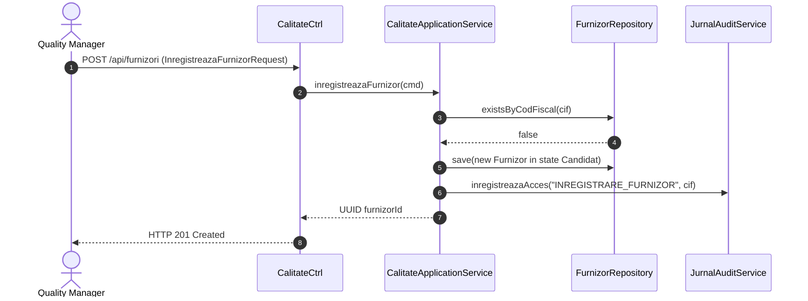

---

### Capability 3: Supplier Evaluation & Monthly Scorecard

* **Objective:** Compute objective performance grade for active vendors based on delivery and quality metrics.
* **Business Context:** Periodic vendor qualification audit executed at month-end.
* **Actors:** System Scheduler / Quality Manager (`ROLE_ADMIN`).
* **Preconditions:** Month interval closed; delivery performance data available.
* **Main Flow:**
  1. Operator or scheduler triggers `POST /api/furnizori/{id}/scorecard`.
  2. System retrieves historical lot deliveries for the target month from `comenzi`.
  3. System derives On-Time-In-Full (OTIF) percentage and Price Compliance percentage.
  4. System retrieves quality inspection pass/fail records from `calitate_inspectii`.
  5. `CalculScorecardService` computes weighted composite score ($40\%\text{ OTIF} + 40\%\text{ Quality} + 20\%\text{ Price}$).
  6. System maps numeric score to letter grade ($A, B, C, D$).
  7. If grade is $C$, vendor transitions to `Condiționat`; if 3 consecutive months $B+$, returns to `Aprobat`.
  8. `ScorecardLunar` record persisted and `shared_audit_log` updated.
* **Alternative Flows:** Interrupted positive streak leaves conditioned vendor in `Condiționat`.
* **Failure Flows:** Invalid month bounds return HTTP 400.
* **Postconditions:** Scorecard persisted; supplier status updated if threshold crossed.
* **Business Rules:** BR-SQ-02.
* **Related Requirements:** FR-QA-05.

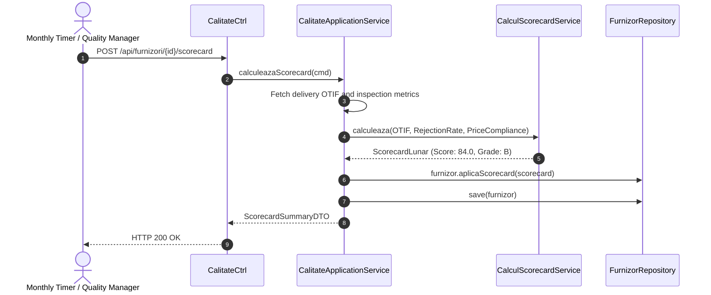

---

### Capability 4: Quality Inspection (ISO 2859-1 AQL)

* **Objective:** Execute statistical lot acceptance sampling on received raw materials.
* **Business Context:** Warehouse dock receiving quality gate preventing defective lots from entering production.
* **Actors:** Quality Inspector (`ROLE_QUALITY_INSPECTOR`).
* **Preconditions:** Lot arrived in dock; inspection in state `InspectorAlocat`; inspector certification active.
* **Main Flow:**
  1. Inspector initiates inspection: `POST /api/inspectii/{id}/start`. System verifies certification validity.
  2. Inspector counts defective units in sample and submits `POST /api/inspectii/{id}/verdict`.
  3. Aggregate `InspectieCalitate` evaluates defect count against $Ac$ and $Re$ limits of `PlanAQL`.
  4. If defects $\le Ac$, inspection transitions to `Conformă` and lot transitions to `Eliberat în stoc`.
  5. `VerdictInspectieEvent` is appended to `shared_outbox_events`.
* **Alternative Flows:** If defects $\ge Re$, inspection transitions to `Neconformă`, lot is marked `Respins`, and Non-Conformance Report (`RaportNeconformitate`) is instantiated.
* **Failure Flows:** Expired inspector certification aborts inspection initiation (HTTP 400).
* **Postconditions:** Lot status updated; verdict event persisted to outbox.
* **Business Rules:** BR-SQ-03.
* **Related Requirements:** FR-QA-03, FR-QA-04.

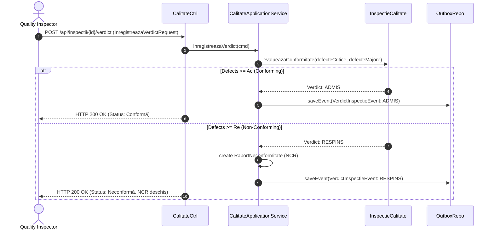

---

### Capability 5: Supplier Invoice Registration (Dual JSON/XML)

* **Objective:** Ingest fiscal invoice received from vendor supporting both JSON and XML/UBL structures.
* **Business Context:** Commercial claim recording against an active Purchase Order.
* **Actors:** Financial Accountant (`ROLE_ACCOUNTANT`, `ROLE_CFO`).
* **Preconditions:** Purchase Order exists; invoice series and number unique for vendor.
* **Main Flow:**
  1. Accountant submits invoice payload via `POST /api/facturi` with `Content-Type: application/json` or `application/xml`.
  2. Spring MVC content negotiation parses request into `InregistreazaFacturaRequest`.
  3. System validates JSR-380 constraints (`@Positive`, `@NotNull`, `@Pattern`).
  4. `FacturaFurnizor` aggregate root is instantiated in initial state `Înregistrată`.
  5. Subtotals and VAT lines are computed and stored.
  6. Invoice persisted into `facturi_facturi` and `facturi_linii_factura`.
  7. System returns HTTP 201 Created with invoice UUID.
* **Alternative Flows:** None.
* **Failure Flows:** Duplicate invoice number throws `DuplicateInvoiceException` (HTTP 409).
* **Postconditions:** Invoice recorded in state `Înregistrată`.
* **Business Rules:** BR-FAC-01.
* **Related Requirements:** FR-AP-01.

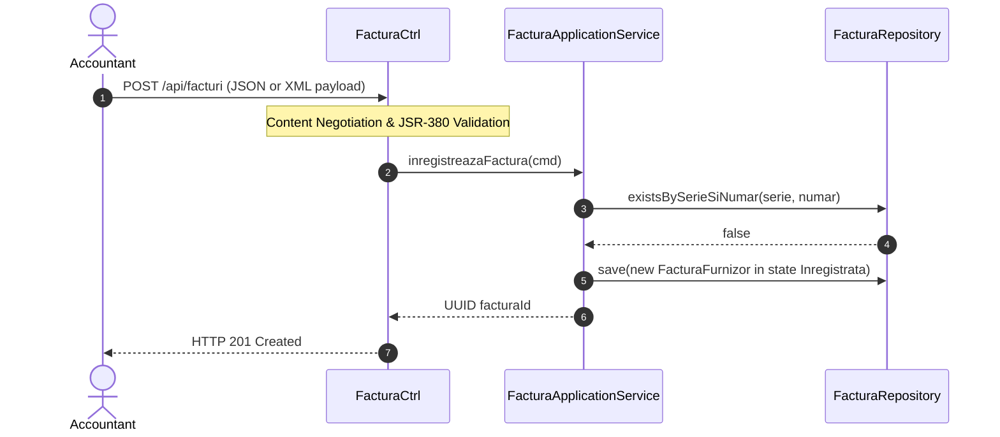

---

### Capability 6: 3-Way Match Invoice Approval

* **Objective:** Mathematically reconcile invoice quantities and prices against Purchase Order and Goods Receipt Note (NIR).
* **Business Context:** Primary accounts payable financial control preventing overpayment and fraudulent claims.
* **Actors:** Financial Accountant (`ROLE_ACCOUNTANT`).
* **Preconditions:** Invoice in state `Înregistrată`; at least one generated NIR exists for referenced order.
* **Main Flow:**
  1. Accountant requests reconciliation: `POST /api/facturi/{id}/reconciliere`.
  2. System loads `FacturaFurnizor` and associated `NIR` aggregate.
  3. System queries `IComenziModuleApi` for original order prices and quantities (`ComandaSummaryDTO`).
  4. `ReconciliereService` computes line-by-line price and quantity variance.
  5. If all variances fall within configured tolerance ($\pm 2\%$), invoice transitions to `Aprobată la plată` and NIR to `Reconciliat`.
  6. Approval decision and variance metrics logged to `shared_audit_log`.
  7. System returns HTTP 200 OK.
* **Alternative Flows:** If variance $>2\%$, see Capability 9 (Invoice Blocking).
* **Failure Flows:** Missing NIR aborts reconciliation with HTTP 409 Conflict.
* **Postconditions:** Invoice unlocked for payment order creation.
* **Business Rules:** BR-FAC-01.
* **Related Requirements:** FR-AP-03.

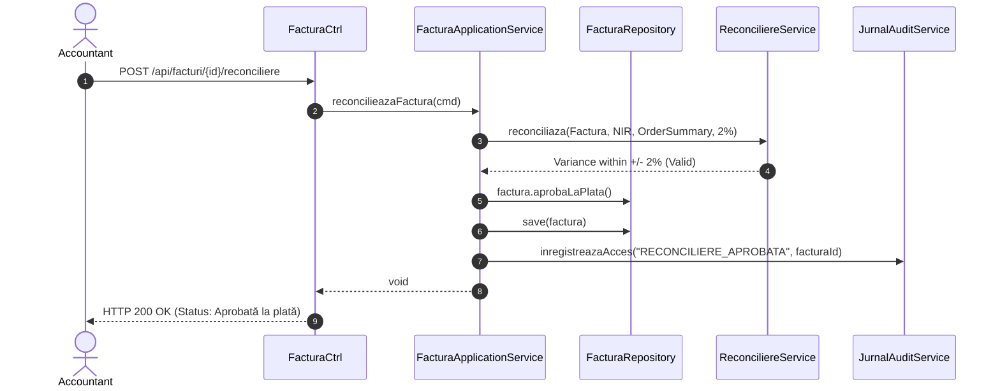

---

### Capability 7: Payment Order Initiation & Four-Eyes Control

* **Objective:** Generate a bank payment order linked to an approved invoice, enforcing Segregation of Duties.
* **Business Context:** Treasury disbursement management preventing internal fraud.
* **Actors:** Accounts Payable Officer (`ROLE_ACCOUNTANT`), Financial Approver (`ROLE_CFO`).
* **Preconditions:** Invoice in state `Aprobată la plată` or `Parțial plătită`; requested sum $\le \text{restDePlata}$.
* **Main Flow:**
  1. Officer submits `CreeazaOrdinPlataRequest` via `POST /api/facturi/{id}/ordine-plata`.
  2. System verifies sum $\le$ remaining balance and instantiates `OrdinPlata` aggregate root in state `Creat`.
  3. If sum $> 10,000\text{ EUR}$, order enters `În aprobare` requiring second approver.
  4. Approver submits approval: `POST /api/ordine-plata/{id}/aprobare?aprobatorId=...`.
  5. Aggregate verifies Four-Eyes invariant: `aprobatorId != creatDe`.
  6. Order transitions to `Aprobat` and is authorized for bank transmission.
* **Alternative Flows:** Orders $\le 10,000\text{ EUR}$ are auto-authorized upon creation.
* **Failure Flows:** If `aprobatorId == creatDe`, system throws `IllegalStateException` (HTTP 400).
* **Postconditions:** Payment order in state `Aprobat`.
* **Business Rules:** BR-FAC-02, BR-FAC-03.
* **Related Requirements:** FR-AP-04, FR-AP-05.

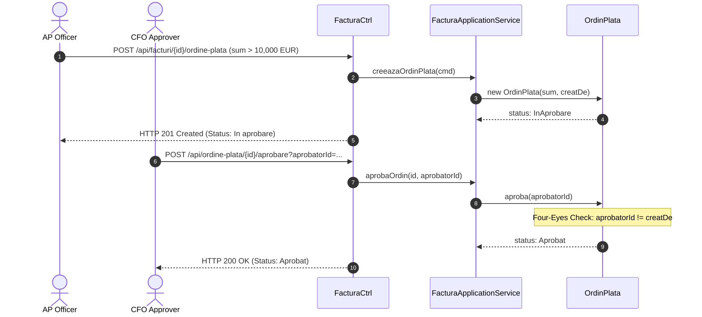

---

### Capability 8: Payment Completion & Balance Settlement

* **Objective:** Record bank clearing execution, reduce invoice outstanding balance, and update invoice status.
* **Business Context:** Bank settlement notification processing.
* **Actors:** Stripe Banking Rail, Application Service.
* **Preconditions:** Payment order was in status `Transmis`.
* **Main Flow:**
  1. Bank clearing notification received and signature verified.
  2. `FacturaApplicationService.proceseazaConfirmarePlata(ordinId, referintaBancara)` executed.
  3. `OrdinPlata` transitions to `Executat`.
  4. System invokes `FacturaFurnizor.inregistreazaPlata(suma)`.
  5. If cumulative paid amount equals invoice total, invoice transitions to `Plătită`.
  6. If remaining balance $>0$, invoice transitions to `Parțial plătită`.
  7. `PlataEfectuataEvent` appended to `shared_outbox_events` and committed to database.
* **Alternative Flows:** None.
* **Failure Flows:** Rejection by bank transitions order to `RespinsDeBanca` and leaves invoice balance unchanged.
* **Postconditions:** Outstanding balance reduced; audit trail updated.
* **Business Rules:** BR-FAC-02.
* **Related Requirements:** FR-AP-06.

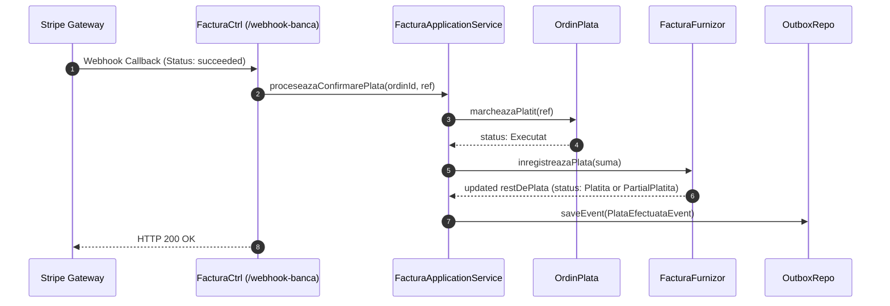

---

### Capability 9: Invoice Blocking on Discrepancy

* **Objective:** Lock non-conforming invoice from payment authorization when 3-way match fails.
* **Business Context:** Automated containment of invoice billing errors.
* **Actors:** Financial Accountant, ReconciliereService.
* **Preconditions:** 3-way match computes price variance or quantity variance $>2\%$.
* **Main Flow:**
  1. `ReconciliereService` detects variance $>2\%$.
  2. System calls `FacturaFurnizor.blocheaza("Discrepanta cantitate/pret")`.
  3. System calls `NIR.marcheazaCuDiscrepante()`.
  4. Invoice enters state `Blocată`; NIR enters state `Cu discrepanțe`.
  5. Discrepancy summary recorded in `shared_audit_log`.
  6. System returns HTTP 409 Conflict.
* **Alternative Flows:** If vendor sends corrective credit note, accountant unlocks invoice back to `În verificare`.
* **Failure Flows:** If discrepancy cannot be resolved, accountant contests invoice (`Contestată`).
* **Postconditions:** Invoice locked; cannot generate payment orders.
* **Business Rules:** BR-FAC-01.
* **Related Requirements:** FR-AP-03.

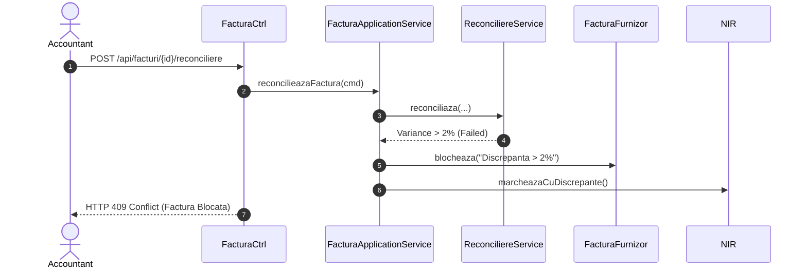

---

### Capability 10: Supplier Sanction & Blocking

* **Objective:** Automatically block non-compliant vendors upon reaching 3 consecutive rejected delivery batches.
* **Business Context:** Vendor quality enforcement and risk containment.
* **Actors:** Quality Inspection Engine, Furnizor Aggregate Root.
* **Preconditions:** Vendor in state `Aprobat` or `Condiționat`.
* **Main Flow:**
  1. Quality inspection registers verdict `RESPINS`.
  2. System calls `Furnizor.inregistreazaInspectieNeconforma()`.
  3. Internal counter `inspectiiNeconformeConsecutive` increments.
  4. When counter reaches 3, `Furnizor` transitions state to `Blocat`.
  5. `FurnizorBlocatPublicEvent` is appended to `shared_outbox_events`.
  6. Sanction logged to `shared_audit_log`.
* **Alternative Flows:** A conforming inspection resets the consecutive counter to 0.
* **Failure Flows:** None.
* **Postconditions:** Vendor state is `Blocat`; barred from receiving new POs or payment disbursements.
* **Business Rules:** BR-SQ-01.
* **Related Requirements:** FR-QA-06.

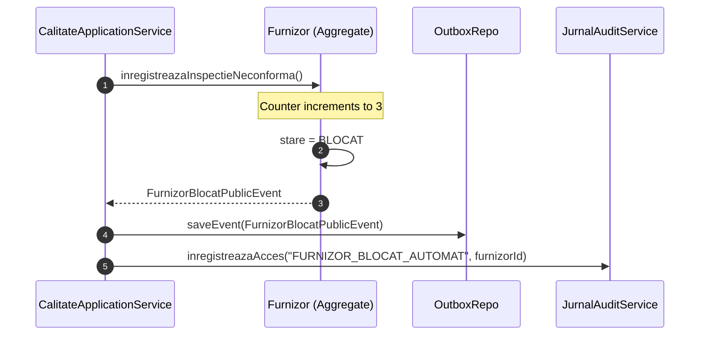

---

### Capability 11: RabbitMQ Event Publishing

* **Objective:** Asynchronously distribute integration domain events across enterprise message queues.
* **Business Context:** Cross-subsystem decoupled integration.
* **Actors:** OutboxDispatcherService, AmqpEventPublisher.
* **Preconditions:** Domain event serialized in `shared_outbox_events`.
* **Main Flow:**
  1. `OutboxDispatcherService` polls unpublished records.
  2. Calls `AmqpEventPublisher.publishDomainEvent(event)`.
  3. Publisher maps event type name to dynamic routing key (`comenzi.*`, `calitate.*`, `facturi.*`).
  4. RabbitTemplate transmits AMQP message to `supplychain.events.exchange`.
  5. Outbox record marked `published = TRUE`.
* **Alternative Flows:** None.
* **Failure Flows:** If broker unreachable, exception is caught and record left unpublished for subsequent retry.
* **Postconditions:** Message delivered to topic exchange.
* **Business Rules:** At-least-once delivery guarantee.
* **Related Requirements:** NFR-SLA-02.

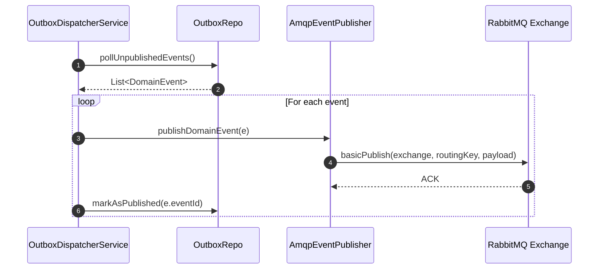

---

### Capability 12: RabbitMQ Event Consumption

* **Objective:** Ingest cross-module AMQP message and execute business reaction idempotently.
* **Business Context:** Decoupled event reaction across bounded contexts.
* **Actors:** RabbitMQ Inbound Consumer, InboxRepoJPA.
* **Preconditions:** Valid AMQP message delivered to queue.
* **Main Flow:**
  1. Inbound listener receives AMQP message with `eventId`.
  2. Listener queries `InboxRepo.existaEveniment(consumer, eventId)`.
  3. If false, listener invokes application command handler.
  4. System executes business reaction within local transaction.
  5. System records `InboxRepo.marcheazaProcesat(consumer, eventId)`.
  6. Message acknowledged (`basicAck`).
* **Alternative Flows:** If event already in inbox, duplicate is dropped and ACK returned immediately (Idempotency).
* **Failure Flows:** Business exception rejects message to Dead-Letter Exchange (`supplychain.events.dlx`).
* **Postconditions:** Business state updated exactly once.
* **Business Rules:** Idempotent consumer pattern.
* **Related Requirements:** NFR-SLA-02.

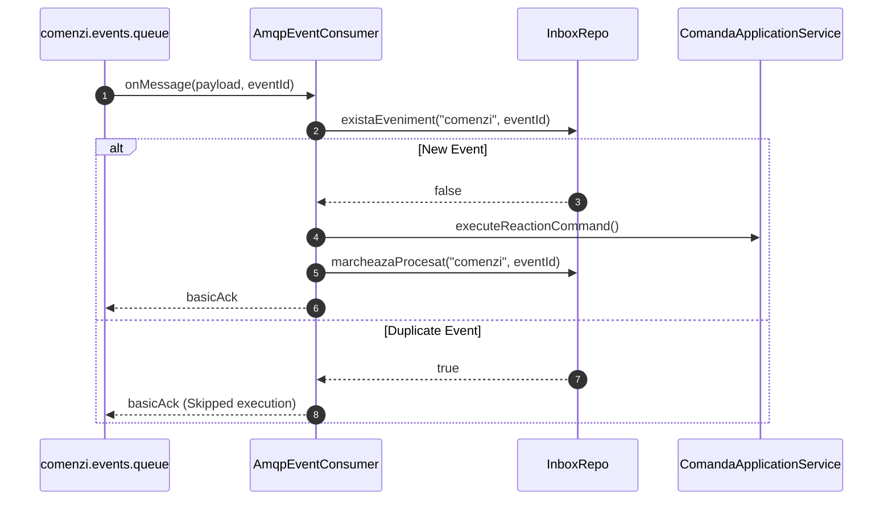

---

### Capability 13: Stripe Outbound Payment Processing

* **Objective:** Transmit authorized payment order to Stripe banking rail sandbox/production API.
* **Business Context:** Electronic supplier payment clearing execution.
* **Actors:** Accounts Payable Officer, StripeBancaPlataAdapter.
* **Preconditions:** Payment order in state `Aprobat`.
* **Main Flow:**
  1. Officer invokes `POST /api/ordine-plata/{id}/transmitere?iban=...`.
  2. Adapter loads API key from `StripeProperties`.
  3. Adapter converts monetary units to fractional cents.
  4. Adapter constructs `PaymentIntentCreateParams` with metadata (`idOrdin`, `facturaId`, `iban`).
  5. Adapter calls `PaymentIntent.create(params)`.
  6. Stripe returns generated payment intent ID (`pi_...`).
  7. Order transitions to `Transmis` and audit entry logged.
* **Alternative Flows:** In test mode with mock keys, adapter generates synthetic reference `pi_mock_...`.
* **Failure Flows:** Stripe network timeout catches `StripeException` and falls back to mock reference with warning log.
* **Postconditions:** Order status is `Transmis`; bank reference stored.
* **Business Rules:** BR-FAC-02.
* **Related Requirements:** FR-AP-06.

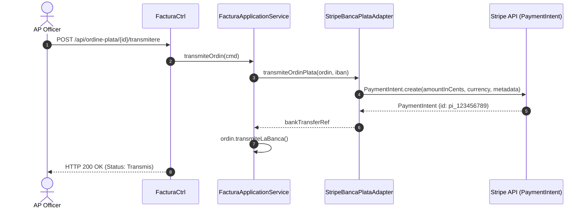

---

### Capability 14: Stripe Refund & Rejection Processing

* **Objective:** Handle failed bank clearing or credit transfer refunds cleanly.
* **Business Context:** Bank clearing exception handling.
* **Actors:** Stripe Gateway, FacturaApplicationService.
* **Preconditions:** Payment order was in status `Transmis`.
* **Main Flow:**
  1. Webhook delivers `payment_intent.payment_failed` event.
  2. Signature verified via HMAC-SHA256.
  3. System calls `OrdinPlata.marcheazaRespins(motiv)`.
  4. Payment order transitions to `RespinsDeBanca`.
  5. Invoice remains in state `Aprobată la plată` with balance intact for re-transmission.
  6. Failure logged to `shared_audit_log`.
* **Alternative Flows:** None.
* **Failure Flows:** Malformed payload returns HTTP 400.
* **Postconditions:** Order marked rejected; invoice balance preserved.
* **Business Rules:** BR-FAC-02.
* **Related Requirements:** FR-AP-06.

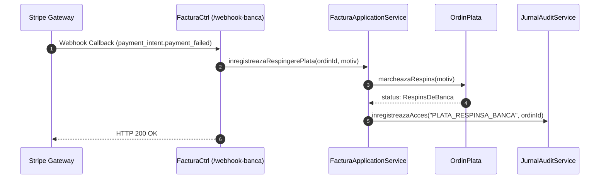

---

### Capability 15: Stripe Webhook Cryptographic Verification

* **Objective:** Verify HMAC-SHA256 signature and timestamp tolerance on inbound Stripe webhooks.
* **Business Context:** Payment security perimeter defense preventing spoofing and replay attacks.
* **Actors:** Inbound Webhook Endpoint, Stripe SDK.
* **Preconditions:** HTTP request includes `Stripe-Signature` header.
* **Main Flow:**
  1. Inbound POST hits `/api/ordine-plata/webhook-banca`.
  2. System verifies `Stripe-Signature` header presence.
  3. System extracts raw request body.
  4. System executes `Webhook.constructEvent(payload, sigHeader, secret, 300)`.
  5. Cryptographic signature and 300s clock drift tolerance validated.
  6. Event dispatched to business service.
* **Alternative Flows:** None.
* **Failure Flows:** Missing header returns HTTP 400 with audit entry `STRIPE_WEBHOOK_REJECTED`. Invalid signature or expired timestamp returns HTTP 400 with audit entry `STRIPE_WEBHOOK_INVALID_SIGNATURE`.
* **Postconditions:** Only authentic Stripe events enter application boundary.
* **Business Rules:** Zero-Trust cryptographic validation.
* **Related Requirements:** SEC-WH-01.

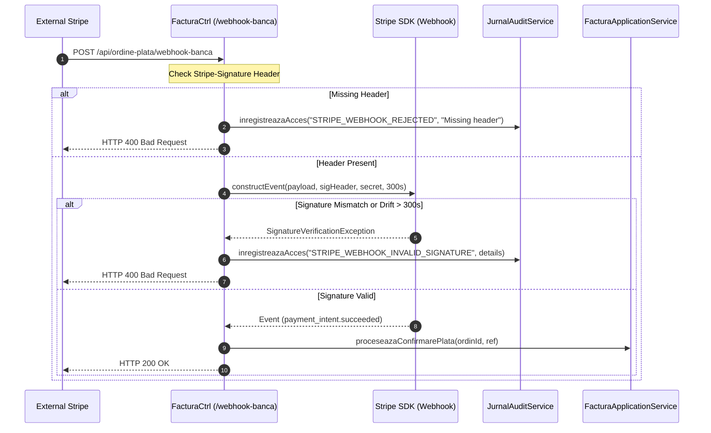

---

### Capability 16: Transactional Outbox Publishing

* **Objective:** Guarantee at-least-once message publication without distributed transaction 2PC overhead.
* **Business Context:** Distributed asynchronous messaging reliability.
* **Actors:** OutboxDispatcherService, PostgreSQL.
* **Preconditions:** Uncommitted business transaction commits aggregate state and outbox record together.
* **Main Flow:**
  1. Poller triggers every 2,000ms: `@Scheduled(fixedDelay = 2000)`.
  2. Reads batch: `SELECT * FROM shared_outbox_events WHERE published = FALSE ORDER BY occurred_on`.
  3. Dispatches event to in-memory Spring Modulith bus.
  4. Dispatches event to RabbitMQ topic exchange via `AmqpEventPublisher`.
  5. Updates record: `UPDATE shared_outbox_events SET published = TRUE, published_on = NOW()`.
* **Alternative Flows:** None.
* **Failure Flows:** If network fails, record remains `published = FALSE` and is re-attempted next cycle.
* **Postconditions:** All domain events eventually published.
* **Business Rules:** Dual-write hazard prevention.
* **Related Requirements:** NFR-SLA-02.

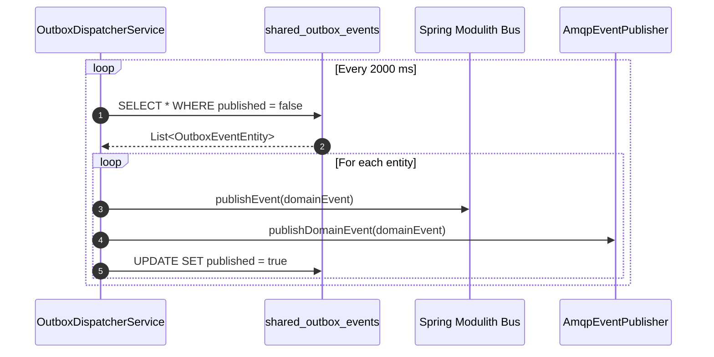

---

### Capability 17: Idempotent Inbox Consumption

* **Objective:** Prevent redundant duplicate business side-effects when messages are redelivered.
* **Business Context:** At-least-once message broker consumer deduplication.
* **Actors:** Inbound AMQP Listener, InboxRepoJPA.
* **Preconditions:** Inbound event contains unique UUID `eventId`.
* **Main Flow:**
  1. Message arrives at consumer queue.
  2. System checks `shared_inbox_events` for key `consumer_name:event_id`.
  3. If absent, consumer executes business logic.
  4. Consumer inserts key into `shared_inbox_events`.
  5. Message acknowledged.
* **Alternative Flows:** If key exists in database, processing is bypassed immediately and message acknowledged.
* **Failure Flows:** Concurrent duplicate delivery blocked by database PRIMARY KEY constraint on `shared_inbox_events.id`.
* **Postconditions:** Aggregate modified exactly once.
* **Business Rules:** Idempotency guarantee.
* **Related Requirements:** NFR-SLA-02.

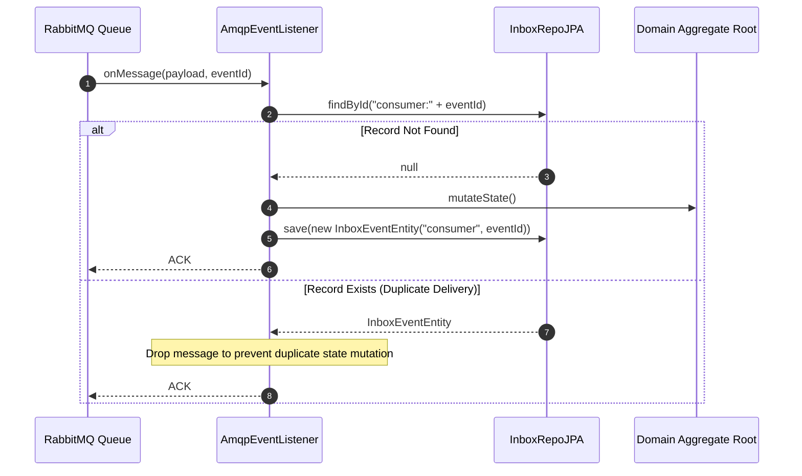
