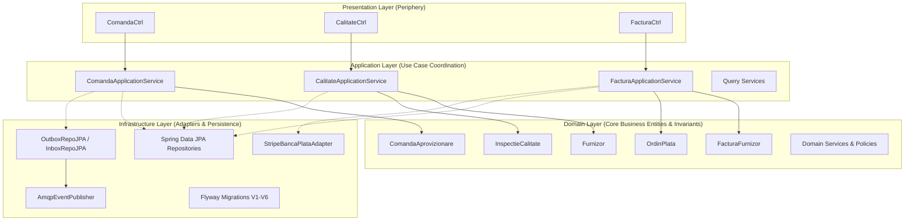
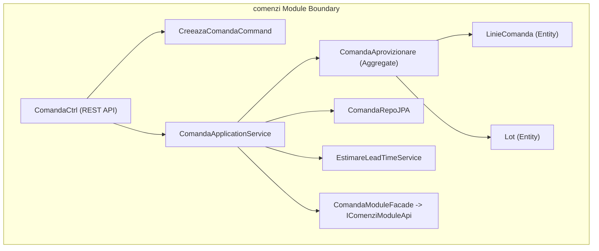
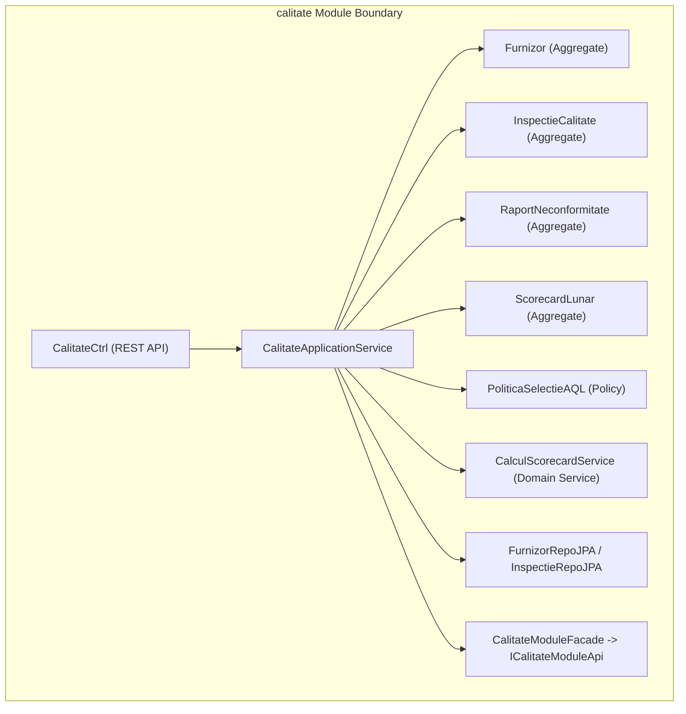
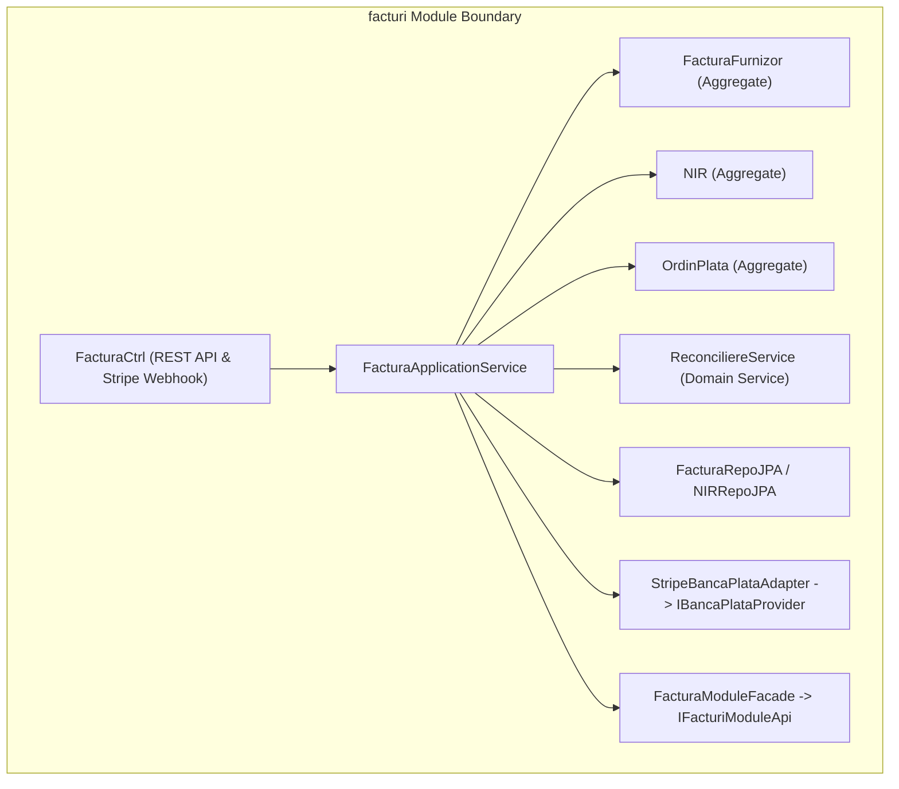
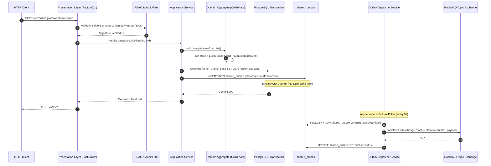

# 07. SYSTEM ARCHITECTURE & COMPONENT TOPOLOGY
**System:** Enterprise Procure-to-Pay (P2P) Supply Chain Modular Monolith  
**Namespace:** `ro.uaic.feaa.sdbis.supplychain`

---

## 1. COMPOSITE ARCHITECTURAL PATTERN

The system synthesizes three architectural paradigms:
1. **Modular Monolith (Package-by-Feature / Bounded Context):** Isolates modules inside a single deliverable (`.jar` or `.war`), preventing premature distributed system complexity.
2. **Clean Architecture (Hexagonal / Ports & Adapters):** Core domain rules occupy the center; persistence, web controllers, and third-party APIs reside on the periphery as adapters.
3. **Event-Driven Architecture (EDA):** Cross-module workflows are coordinated asynchronously via transactional domain events.

---

## 2. COMPONENT TOPOLOGY PER BOUNDED CONTEXT

### A. Comenzi Bounded Context Component Model

### B. Calitate Bounded Context Component Model

### C. Facturi Bounded Context Component Model

---

## 3. END-TO-END DATA FLOW ARCHITECTURE

