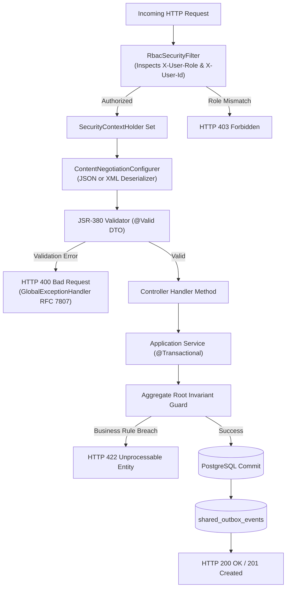

# 13. COMPLETE REST API REFERENCE CATALOG & ENDPOINT MATRIX
**System:** Enterprise Procure-to-Pay (P2P) Supply Chain Modular Monolith  
**Namespace:** `ro.uaic.feaa.sdbis.supplychain`

---

## 1. COMPREHENSIVE ENDPOINT MATRIX

| Module | Method | URI Pattern | Controller | Request DTO / Parameters | Use Case | Business Rule | Authorization | Validation | Response Type |
|---|---|---|---|---|---|---|---|---|---|
| `comenzi` | `POST` | `/api/comenzi` | `ComandaCtrl` | `CreeazaComandaRequest` | UC-01: Creare Comandă | BR-PO-01, 02 | `ROLE_BUYER`, `ROLE_ADMIN` | `@Valid`, `@NotBlank`, `@NotEmpty` | `201 Created` (`IdComandaDTO`) |
| `comenzi` | `PUT` | `/api/comenzi/{id}` | `ComandaCtrl` | `dataLivrareCeruta, depozit` | UC-02: Editare Comandă | BR-PO-01 | `ROLE_BUYER`, `ROLE_ADMIN` | Date $\ge$ Today | `200 OK` |
| `comenzi` | `DELETE`| `/api/comenzi/{id}` | `ComandaCtrl` | Path `id` | UC-03: Ștergere Comandă | BR-PO-01 | `ROLE_BUYER`, `ROLE_ADMIN` | Only `Solicitat` | `204 No Content` |
| `comenzi` | `POST` | `/api/comenzi/{id}/trimitere` | `ComandaCtrl` | Path `id` | UC-04: Trimitere la Furnizor | BR-PO-02 | `ROLE_BUYER`, `ROLE_ADMIN` | Order is `Solicitat` | `200 OK` |
| `comenzi` | `POST` | `/api/comenzi/{id}/confirmare`| `ComandaCtrl` | Query `dataPromisa` | UC-05: Confirmare Furnizor | BR-PO-02 | `ROLE_SUPPLIER`, `ROLE_ADMIN`| ISO Date format | `200 OK` |
| `comenzi` | `POST` | `/api/comenzi/{id}/refuz` | `ComandaCtrl` | Path `id` | UC-06: Refuz Furnizor | BR-PO-02 | `ROLE_SUPPLIER`, `ROLE_ADMIN`| Order is `Solicitat` | `200 OK` |
| `comenzi` | `POST` | `/api/comenzi/{id}/expedieri` | `ComandaCtrl` | `transportator, awb, loturiIds` | UC-07: Expediere Loturi | BR-PO-03 | `ROLE_SUPPLIER`, `ROLE_ADMIN`| Valid AWB string | `200 OK` |
| `comenzi` | `POST` | `/api/comenzi/{id}/receptii` | `ComandaCtrl` | `lotId, cantitate` | UC-08: Recepție Marfă Lot | BR-PO-04 | `ROLE_WAREHOUSE_KEEPER` | `cantitate > 0` | `200 OK` |
| `comenzi` | `POST` | `/api/comenzi/{id}/anulare` | `ComandaCtrl` | Path `id` | UC-09: Anulare în Cascadă | BR-PO-03 | `ROLE_BUYER`, `ROLE_ADMIN` | Order not `Finalizată` | `200 OK` |
| `comenzi` | `POST` | `/api/comenzi/{id}/estimare-livrare`| `ComandaCtrl`| Path `id` | UC-10: Estimare Lead Time | SLA $<300\text{ms}$ | `ROLE_BUYER`, `ROLE_ADMIN` | Order exists | `200 OK` (`EstimareLivrareDTO`) |
| `comenzi` | `POST` | `/api/comenzi/{id}/loturi` | `ComandaCtrl` | `codLot, materialCod, cantitate, productie, expirare` | UC-11: Planificare Lot | Lot Boundary | `ROLE_BUYER`, `ROLE_ADMIN` | `cantitate > 0`, dates | `201 Created` (`IdLotDTO`) |
| `comenzi` | `POST` | `/api/comenzi/{id}/loturi/{lotId}/carantina` | `ComandaCtrl` | Path `id, lotId` | UC-12: Carantinare Lot | Quality Gate | `ROLE_QUALITY_INSPECTOR` | Lot is `SositInDepozit` | `200 OK` |
| `comenzi` | `POST` | `/api/comenzi/{id}/loturi/{lotId}/verdict` | `ComandaCtrl` | Query `rezultat` | UC-13: Aplicare Verdict | BR-SQ-03 | `ROLE_QUALITY_INSPECTOR` | `CONFORM` / `NECONFORM` | `200 OK` |
| `comenzi` | `POST` | `/api/comenzi/{id}/loturi/{lotId}/retur` | `ComandaCtrl` | Path `id, lotId` | UC-14: Retur Furnizor | Defect Mgmt | `ROLE_WAREHOUSE_KEEPER` | Lot is `Respins` | `200 OK` |
| `comenzi` | `GET` | `/api/comenzi/loturi/{codLot}/trasabilitate` | `ComandaCtrl` | Path `codLot` | UC-15: Trasabilitate Lot | Traceability | `ROLE_BUYER`, `ROLE_ADMIN` | Non-empty code | `200 OK` (`TrasabilitateLotView`) |
| `comenzi` | `GET` | `/api/comenzi/rapoarte/otif` | `ComandaCtrl` | Query `furnizorId` (optional) | UC-16: Dashboard OTIF | Metric Reporting | `ROLE_BUYER`, `ROLE_ADMIN` | Valid UUID if present | `200 OK` (`DashboardLivrariView`) |
| `calitate`| `POST` | `/api/furnizori` | `CalitateCtrl` | `InregistreazaFurnizorRequest` | UC-17: Înregistrare Furnizor | BR-SQ-01 | `ROLE_QUALITY_INSPECTOR` | `@Valid`, `@NotBlank`, `@Email` | `201 Created` (`furnizorId`) |
| `calitate`| `PUT` | `/api/furnizori/{id}` | `CalitateCtrl` | `denumire, iban` | UC-18: Actualizare Furnizor | Profile Mgmt | `ROLE_QUALITY_INSPECTOR` | Valid IBAN regex | `200 OK` |
| `calitate`| `POST` | `/api/furnizori/{id}/calificare` | `CalitateCtrl` | `decizie, motiv` | UC-19: Calificare Furnizor | BR-SQ-01 | `ROLE_QUALITY_INSPECTOR` | `Aprobat` / `Conditionat` | `200 OK` |
| `calitate`| `POST` | `/api/inspectori` | `CalitateCtrl` | `CreeazaInspectorRequest` | UC-20: Creare Inspector | Profile Mgmt | `ROLE_QUALITY_INSPECTOR` | `@Valid`, `@NotBlank` | `201 Created` (`inspectorId`) |
| `calitate`| `POST` | `/api/inspectori/{id}/certificari` | `CalitateCtrl` | `denumire, dataExpirare` | UC-21: Adăugare Certificare | Certification | `ROLE_QUALITY_INSPECTOR` | Future expiry date | `200 OK` |
| `calitate`| `POST` | `/api/inspectori/{id}/disponibilitate`| `CalitateCtrl` | `deLa, panaLa` | UC-22: Disponibilitate | Availability | `ROLE_QUALITY_INSPECTOR` | `panaLa >= deLa` | `200 OK` |
| `calitate`| `POST` | `/api/inspectii/{id}/alocare` | `CalitateCtrl` | Query `inspectorId` | UC-23: Alocare Inspector | Certification Guard | `ROLE_QUALITY_INSPECTOR` | Certified on period | `200 OK` |
| `calitate`| `POST` | `/api/inspectii/{id}/start` | `CalitateCtrl` | Path `id` | UC-24: Începere Inspecție | Certification Active | `ROLE_QUALITY_INSPECTOR` | Active cert on date | `200 OK` |
| `calitate`| `POST` | `/api/inspectii/{id}/verdict` | `CalitateCtrl` | `InregistreazaVerdictRequest` | UC-25: Înregistrare Verdict | BR-SQ-03 | `ROLE_QUALITY_INSPECTOR` | `@PositiveOrZero int` | `200 OK` |
| `calitate`| `POST` | `/api/inspectii/{id}/reinspectie` | `CalitateCtrl` | Path `id` | UC-26: Reinspecție Lot | Defect Handling | `ROLE_QUALITY_INSPECTOR` | Inspection is `Neconformă`| `200 OK` |
| `calitate`| `POST` | `/api/ncr/{id}/cauza` | `CalitateCtrl` | Query `cauza` | UC-27: Analiză Cauză NCR | NCR Flow | `ROLE_QUALITY_INSPECTOR` | Non-blank string | `200 OK` |
| `calitate`| `POST` | `/api/ncr/{id}/actiune` | `CalitateCtrl` | `InitiazaActiuneNCRRequest` | UC-28: Acțiune Corectivă | NCR Flow | `ROLE_QUALITY_INSPECTOR` | `@Valid`, `@NotBlank` | `200 OK` |
| `calitate`| `POST` | `/api/ncr/{id}/verificare` | `CalitateCtrl` | Path `id` | UC-29: Verificare Acțiune NCR| NCR Flow | `ROLE_QUALITY_INSPECTOR` | Status `ActiuneInCurs` | `200 OK` |
| `calitate`| `POST` | `/api/ncr/{id}/inchidere` | `CalitateCtrl` | Path `id` | UC-30: Închidere NCR | NCR Flow | `ROLE_QUALITY_INSPECTOR` | Status `Verificat` | `200 OK` |
| `calitate`| `POST` | `/api/ncr/{id}/escaladare` | `CalitateCtrl` | Path `id` | UC-31: Escaladare NCR | NCR Flow | `ROLE_QUALITY_INSPECTOR` | Ineffective action | `200 OK` |
| `calitate`| `POST` | `/api/furnizori/{id}/scorecard-lunar`| `CalitateCtrl` | `CalculScorecardRequest` | UC-32: Scorecard Lunar | BR-SQ-02 | `ROLE_ADMIN` | `@Valid`, `@Min`, `@Max` | `200 OK` (`ScorecardLunarDTO`) |
| `calitate`| `GET` | `/api/furnizori/rapoarte/monitorizare`| `CalitateCtrl`| None | UC-33: Monitorizare Furnizori | Monitoring | `ROLE_QUALITY_INSPECTOR` | None | `200 OK` (`MonitorizareFurnizoriView`) |
| `facturi` | `POST` | `/api/facturi` | `FacturaCtrl` | `InregistreazaFacturaRequest` | UC-34: Înregistrare Factură | Dual JSON/XML | `ROLE_ACCOUNTANT`, `ROLE_CFO`| `@Valid`, `@Positive`, `@NotBlank`| `201 Created` (`facturaId`) |
| `facturi` | `POST` | `/api/facturi/{id}/contestare` | `FacturaCtrl` | Query `motiv` | UC-35: Contestare Factură | Discrepancy Flow | `ROLE_ACCOUNTANT` | Non-blank string | `200 OK` |
| `facturi` | `POST` | `/api/facturi/{id}/reconciliere` | `FacturaCtrl` | Path `id` | UC-36: 3-Way Match | BR-FAC-01 | `ROLE_ACCOUNTANT`, `ROLE_CFO`| NIR exists | `200 OK` / `409 Conflict` |
| `facturi` | `POST` | `/api/nir/{id}/contabilizare` | `FacturaCtrl` | Path `id` | UC-37: Contabilizare NIR | Accounting | `ROLE_ACCOUNTANT` | NIR is `Reconciliat` | `200 OK` |
| `facturi` | `POST` | `/api/nir/{id}/stornare` | `FacturaCtrl` | Query `motiv` | UC-38: Stornare NIR | Accounting | `ROLE_ACCOUNTANT` | Non-blank string | `200 OK` |
| `facturi` | `POST` | `/api/facturi/{id}/ordine-plata` | `FacturaCtrl` | `CreeazaOrdinPlataRequest` | UC-39: Creare Ordin Plată | BR-FAC-02 | `ROLE_ACCOUNTANT`, `ROLE_CFO`| `@Positive suma <= rest` | `201 Created` (`ordinId`) |
| `facturi` | `POST` | `/api/ordine-plata/{id}/aprobare` | `FacturaCtrl` | Query `aprobatorId` | UC-40: Aprobare Four-Eyes | BR-FAC-03 | `ROLE_CFO`, `ROLE_ADMIN` | `aprobatorId != creatDe` | `200 OK` |
| `facturi` | `POST` | `/api/ordine-plata/{id}/transmitere` | `FacturaCtrl` | Query `iban` | UC-41: Transmitere la Bancă | Stripe Gateway | `ROLE_ACCOUNTANT`, `ROLE_CFO`| Valid IBAN, Vendor unblocked | `200 OK` |
| `facturi` | `POST` | `/api/ordine-plata/webhook-banca` | `FacturaCtrl` | Raw body + `Stripe-Signature`| UC-42: Stripe Webhook | SEC-WH-01 | Public (HMAC Verified) | HMAC-SHA256 & 300s drift | `200 OK` (`ordinId, status`) |
| `facturi` | `GET` | `/api/facturi/scadente` | `FacturaCtrl` | None | UC-43: Scadențar Facturi | Treasury Forecast | `ROLE_ACCOUNTANT`, `ROLE_CFO`| None | `200 OK` (`List<FacturaScadentaView>`) |

---

## 2. API REQUEST PROCESSING & SECURITY PIPELINE

