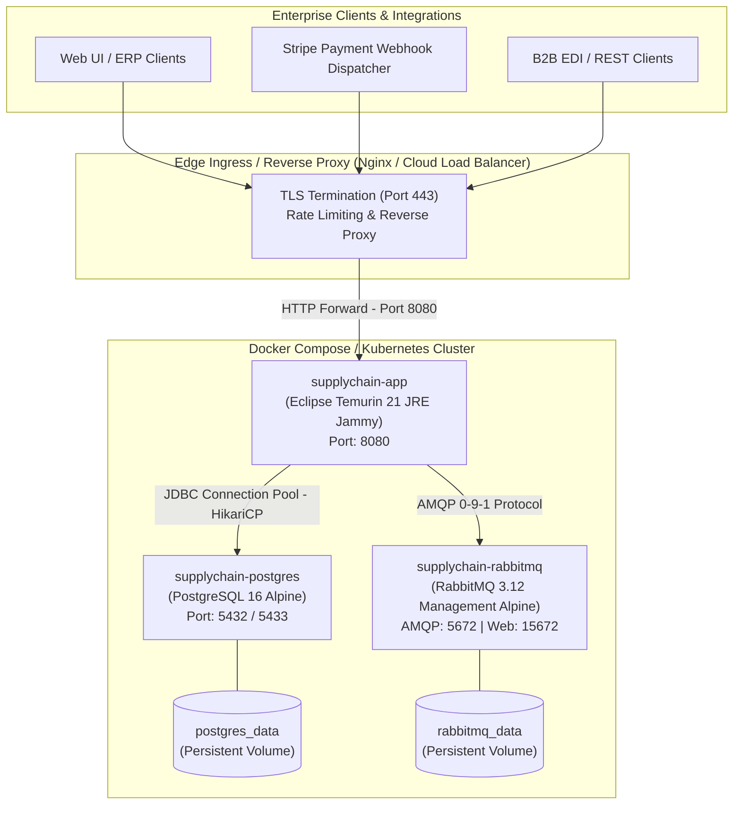

# 26. CONTAINERIZATION, DEPLOYMENT & INFRASTRUCTURE TOPOLOGY
**System:** Enterprise Procure-to-Pay (P2P) Supply Chain Modular Monolith  
**Namespace:** `ro.uaic.feaa.sdbis.supplychain`

---

## 1. ENTERPRISE DEPLOYMENT ARCHITECTURE

The platform supports both modern **Containerized Cloud-Native Deployments** (Docker / Kubernetes) and **Traditional Enterprise Application Server Deployments** (Apache Tomcat 10.1+ via `SpringBootServletInitializer`).



---

## 2. MULTI-STAGE DOCKERFILE ANALYSIS

Declared in [Dockerfile](file:///c:/Users/bmugu/Desktop/app/Dockerfile):

```dockerfile
# Stage 1: Build Application
FROM eclipse-temurin:21-jdk-jammy AS builder
WORKDIR /workspace

COPY .mvn/ .mvn/
COPY mvnw pom.xml ./
RUN sed -i 's/\r$//' mvnw && chmod +x mvnw && ./mvnw dependency:go-offline -B || true

COPY src ./src
RUN ./mvnw clean package -DskipTests

# Stage 2: Hardened Runtime Environment
FROM eclipse-temurin:21-jre-jammy
WORKDIR /app

# Non-root user for enterprise container security (Least Privilege)
RUN groupadd -r supplychain && useradd -r -g supplychain -s /bin/false supplychain

# Install curl for container health checks
RUN apt-get update && apt-get install -y --no-install-recommends curl && rm -rf /var/lib/apt/lists/*

COPY --from=builder /workspace/target/supplychain-p2p-*.jar app.jar
RUN chown -R supplychain:supplychain /app

USER supplychain
EXPOSE 8080

HEALTHCHECK --interval=30s --timeout=5s --start-period=40s --retries=3 \
  CMD curl -f http://localhost:8080/actuator/health || exit 1

ENTRYPOINT ["java", "-XX:+UseG1GC", "-Djava.security.egd=file:/dev/./urandom", "-jar", "app.jar"]
```

### Container Hardening Highlights
1. **Multi-Stage Build:** Build tools, Maven cache, and source code are discarded in the final image, keeping the footprint minimal and eliminating build-time vulnerability exposure.
2. **Non-Root Execution:** Runs under user `supplychain` (`uid:gid`), blocking privilege escalation container breakouts.
3. **Optimized Garbage Collection:** Configured with `-XX:+UseG1GC` and `/dev/urandom` entropy for low-latency Java 21 execution.
4. **Automated Docker Healthcheck:** Actuator `/actuator/health` probe polls every 30 seconds with 40s start grace period.

---

## 3. MULTI-SERVICE COMPOSE TOPOLOGY (`docker-compose.yml`)

The multi-container orchestration is defined in [docker-compose.yml](file:///c:/Users/bmugu/Desktop/app/docker-compose.yml):

| Service | Container Name | Base Image | Internal Port | Host Port | Health Check Mechanism |
|---|---|---|---|---|---|
| **Database** | `supplychain-postgres` | `postgres:16-alpine` | `5432` | `${POSTGRES_PORT:-5433}` | `pg_isready -U supplychain -d supplychain_db` |
| **Broker** | `supplychain-rabbitmq` | `rabbitmq:3-management-alpine` | `5672`, `15672` | `5672`, `15672` | `rabbitmq-diagnostics -q ping` |
| **Application** | `supplychain-app` | `eclipse-temurin:21-jre-jammy` | `8080` | `8080` | `curl -f http://localhost:8080/actuator/health` |

### Service Dependency & Startup Synchronization
The application container waits for PostgreSQL and RabbitMQ to pass their health checks before launching:
```yaml
depends_on:
  postgres:
    condition: service_healthy
  rabbitmq:
    condition: service_healthy
```

---

## 4. STANDALONE WAR APPLICATION SERVER DEPLOYMENT

For enterprises requiring deployment on shared application servers (e.g., Apache Tomcat 10.1 or Eclipse Jetty), the platform provides [WebInitializer.java](file:///c:/Users/bmugu/Desktop/app/src/main/java/ro/uaic/feaa/sdbis/supplychain/WebInitializer.java):

```java
public class WebInitializer extends SpringBootServletInitializer {
    @Override
    protected SpringApplicationBuilder configure(SpringApplicationBuilder application) {
        return application.sources(SupplyChainApplication.class);
    }
}
```

Packaging the artifact as a WAR file:
```bash
mvn clean package -DskipTests
# Produces target/supplychain-p2p-1.0.0-SNAPSHOT.war
```

---

## 5. ENVIRONMENT PROFILE MATRIX

| Profile Name | Target Environment | Database Engine | Flyway Strategy | Hibernate DDL | RabbitMQ Host |
|---|---|---|---|---|---|
| **Default / Test** | Local IDE / In-Memory Unit Tests | In-Memory H2 | `spring.flyway.enabled=true` | `validate` / `create-drop` | Mock / Test Broker |
| **postgres** | Docker Compose Staging | PostgreSQL 16 (docker) | `spring.flyway.enabled=true` | `validate` | `rabbitmq:5672` |
| **postgres-local** | Bare-metal Dev / Developer Workstation | PostgreSQL 16 (localhost) | `spring.flyway.enabled=true` | `validate` | `localhost:5672` |
| **prod** | Production Kubernetes / Cloud | AWS RDS / Azure PG | `spring.flyway.enabled=true` | `validate` | Cluster AMQP AMQPS |

